# REGLAS DE NEGOCIO Y MANUAL TÉCNICO DE LIMPIEZA
## PROYECTO INTEGRADOR: PIPELINE ETL ROBUSTO CON ZONA DE CUARENTENA
**Tecnológico Nacional de México | Instituto Tecnológico de Colima**  
*Departamento de Sistemas y Computación | Materia: Ingeniería de Datos (ATD-2602)*  
*Semestre Ago-Dic 2026 | Unidad 2: Limpieza y Preprocesamiento de Datos*  
**Sector Asignado:** Retail & E-commerce Omnicanal (Grupo 1 - LCS2)  

---

## 1. Matriz de Responsabilidades de Ingeniería (Equipo de 3 Integrantes)

| Rol Oficial | Especialidad Técnica | Responsabilidades Específicas | Entregable Clave | Firma de Conformidad |
| :--- | :--- | :--- | :--- | :--- |
| **Ingeniero/a 1** | *Calidad, Nulos y Outliers* | • Perfilado cuantitativo inicial de calidad (completitud, unicidad, dtypes).<br>• Clasificación formal de ausencias (MCAR vs. MAR).<br>• Imputación de faltantes numéricos con mediana justificando matemáticamente la no utilización de la media.<br>• Detección de anomalías y bots mediante IQR (1.5) y aplicación de Capping / Winsorizing en importes y cantidades. | Funciones de limpieza estadística + Reporte comparativo de calidad antes/después. | *Ing. 1 - Calidad y Estadísticas* |
| **Ingeniero/a 2** | *Transformación e Integración* | • Fusión de fuentes heterogéneas (`ventas_tienda_fisica.csv` + `ventas_online.json`).<br>• Normalización multiformato de fechas al estándar ISO (`YYYY-MM-DD`).<br>• Conversión de divisas (USD a MXN a tipo de cambio oficial $19.50).<br>• Cruce con `catalogo_productos.csv` y aislamiento de llaves huérfanas.<br>• Escalamiento Min-Max $[0, 1]$ y discretización en 3 segmentos (*Bajo, Medio, Alto*). | Módulo de integración multifuente y normalización de variables. | *Ing. 2 - Integración y Normalización* |
| **Ingeniero/a 3** | *Validación, Resiliencia y BD* | • Modelado de clases estrictas `BaseModel` con Pydantic v2 y `@field_validator`.<br>• Mecanismo de segregación: transacciones aptas vs. zona de cuarentena con causa auditable.<br>• Persistencia en base de datos relacional SQLite con transacciones seguras (`commit` / `rollback`).<br>• Batería de pruebas de estrés con inyección de datos hostiles (Principio *No Crash*). | Esquemas Pydantic + Script de carga relacional + Batería de pruebas de estrés. | *Ing. 3 - Resiliencia y Base de Datos* |

---

## 2. Diagrama de Arquitectura y Flujo del Pipeline ETL

```mermaid
flowchart TD
    subgraph INGESTION["1. Ingestión de Fuentes Heterogéneas"]
        F1["ventas_tienda_fisica.csv<br/>(620 registros)"]
        F2["ventas_online.json<br/>(600 registros)"]
        CAT["catalogo_productos.csv<br/>(50 productos)"]
    end

    subgraph DIAGNOSTICO["2. Diagnóstico de Calidad Inicial (Fase 1)"]
        D1["Perfilado Cuantitativo:<br/>Completitud (% nulos)<br/>Unicidad (20 dups POS)<br/>Dtypes inferidos"]
    end

    subgraph PREPROC["3. Limpieza, Imputación y Homologación (Fases 2 & 4)"]
        P1["Detección de Duplicados POS"]
        P2["Filtrado Cantidades Imposibles (<= 0)"]
        P3["Imputación MCAR:<br/>id_cliente = 'ANONIMO'<br/>shipping_address = 'SIN_DIRECCION'"]
        P4["Unificación de Fechas a ISO YYYY-MM-DD<br/>(DD/MM/YYYY, DD-MM-YYYY, Unix Epoc -> ISO)"]
        P5["Normalización de Divisas:<br/>USD a MXN @ $19.50"]
        P6["Recálculo de Totales:<br/>monto_total = cantidad * precio_unitario"]
    end

    subgraph CRUCE["4. Enriquecimiento y Detección de Huérfanos"]
        M1["Cruce INNER / LEFT con Catálogo Maestro"]
        M2{"¿id_producto existe en catálogo?"}
    end

    subgraph OUTLIERS["5. Tratamiento Estadístico de Outliers (Fase 3)"]
        O1["Cálculo de IQR = Q3 - Q1 (Factor 1.5)"]
        O2["Capping / Winsorizing:<br/>Recorte de compras gigantes de bots a 6 unidades<br/>Preservación de cantidad_original"]
    end

    subgraph NORMALIZACION["6. Escalamiento y Discretización (Fase 5)"]
        N1["Escalamiento Min-Max [0, 1] en monto_total_mxn"]
        N2["Discretización por Cuantiles:<br/>Terciles -> 'Bajo', 'Medio', 'Alto'"]
    end

    subgraph VALIDACION["7. Validación Pydantic v2 (Fase 6)"]
        V1["Evaluación con TransaccionLimpiaSchema"]
        V2{"try ... except<br/>ValidationError"}
    end

    subgraph DESTINO["8. Persistencia Relacional Transaccional (Fase 7)"]
        DB_CLEAN[("transacciones_limpias<br/>(1,084 registros)")]
        DB_QUAR[("cuarentena_errores<br/>(136 registros)")]
    end

    F1 --> D1
    F2 --> D1
    CAT --> D1

    D1 --> P1
    P1 -- "Duplicado POS" --> DB_QUAR
    P1 -- "Único" --> P2
    P2 -- "Cantidad <= 0" --> DB_QUAR
    P2 -- "Cantidad > 0" --> P3
    P3 --> P4
    P4 --> P5
    P5 --> P6
    P6 --> M1
    CAT --> M1

    M1 --> M2
    M2 -- "No (Huérfano)" --> DB_QUAR
    M2 -- "Sí (Válido)" --> O1

    O1 --> O2
    O2 --> N1
    N1 --> N2
    N2 --> V1

    V1 --> V2
    V2 -- "Conforme (Aprobado)" --> DB_CLEAN
    V2 -- "Violación de Esquema" --> DB_QUAR

    style DB_CLEAN fill:#10b981,stroke:#047857,stroke-width:2px,color:#ffffff
    style DB_QUAR fill:#ef4444,stroke:#b91c1c,stroke-width:2px,color:#ffffff
    style INGESTION fill:#1e293b,stroke:#475569,stroke-width:2px,color:#f8fafc
    style DESTINO fill:#0f172a,stroke:#334155,stroke-width:2px,color:#f8fafc
```



---

## 3. Justificación Técnica de las Decisiones de Limpieza y Negocio

### 3.1. Fase 1: Diagnóstico de Calidad Inicial (Perfilado Cuantitativo)
Antes de ejecutar cualquier mutación sobre los datos, se realizó un escaneo computacional exhaustivo sobre los 3 conjuntos crudos:
- **`catalogo_productos.csv`**: 50 registros maestros con 100% de completitud y unicidad. Sirve como la fuente de verdad (*Golden Source*).
- **`ventas_tienda_fisica.csv`**: 620 transacciones crudas.
  - *Completitud*: 127 ausencias en `id_cliente` (20.48%) y 32 ausencias en `monto_total_mxn` (5.16%).
  - *Unicidad*: 20 registros duplicados exactos generados por dobles lecturas de escáner en Terminal Punto de Venta (POS).
  - *Valores imposibles*: 11 transacciones con cantidades nulas o negativas ($\le 0$).
  - *Outliers*: Compras atípicas de 99 y 500 unidades.
- **`ventas_online.json`**: 600 órdenes digitales.
  - *Completitud*: 15 registros con `customer_email` nulo, 33 correos con formato roto (sin `@`, dobles dominios o cadenas vacías) y 77 ausencias en `shipping_address`.
  - *Heterogeneidad de formatos*: Timestamps expresados como Unix Epoch enteros (208 registros) y cadenas ISO con marca de tiempo (392 registros).
  - *Moneda mixta*: 407 órdenes en MXN y 193 órdenes en USD.

---

### 3.2. Fase 2: Manejo de Faltantes y Clasificación Teórica (MCAR vs. MAR)

#### A. Clasificación Teórica de Ausencias
1. **`id_cliente` en Tienda Física (MCAR - Missing Completely at Random):**
   - *Justificación*: En el comercio minorista físico, los clientes de paso (walk-in customers) que pagan en efectivo o mostrador comúnmente rechazan proporcionar datos personales o afiliarse al programa de lealtad al no requerir comprobante fiscal. La probabilidad de ausencia es independiente de los atributos intrínsecos de la compra.
   - *Técnica aplicada*: Imputación con etiqueta categórica controlada: `'ANONIMO'`.
2. **`shipping_address` en Tienda Online (MAR - Missing at Random):**
   - *Justificación*: En plataformas web, cuando una compra corresponde a recolección programada en punto físico (*BOPIS: Buy Online, Pick-up In Store*) o suscripciones, el campo de dirección física no se captura en el formulario de envío.
   - *Técnica aplicada*: Imputación con valor por defecto `'SIN_DIRECCION'`.
3. **`monto_total_mxn` en Tienda Física:**
   - *Justificación*: No se recurre a imputaciones aproximadas cuando el valor se puede derivar con exactitud matemática a partir de otras variables:
   $$\text{monto\_total\_mxn} = \text{cantidad} \times \text{precio\_unitario}$$
   Esta sustitución determinista repara los 32 nulos sin introducir sesgo estocástico.

#### B. Justificación de la Mediana sobre la Media
En distribuciones asimétricas (sesgo a la derecha provocado por órdenes mayoristas y bots), la media aritmética se ve fuertemente distorsionada:
$$\bar{x} = \frac{1}{n}\sum_{i=1}^n x_i$$
La media se desplaza hacia valores artificialmente altos ($\bar{x} = \$16,586.74$ MXN en datos crudos), mientras que la **mediana** ($Me = \$3,506.37$ MXN) es un estimador robusto no paramétrico que representa el valor central real del 50% de las ventas. Por tanto, ante cualquier imputación numérica central se prescribe la mediana.

---

### 3.3. Fase 3: Detección y Tratamiento de Outliers con IQR (Capping / Winsorizing)

#### A. Fundamento Matemático del Rango Intercuartílico
Se aplica el método de John Tukey basado en los cuartiles de la distribución empírica:
1. Primer cuartil ($Q_1$ o percentil 25).
2. Tercer cuartil ($Q_3$ o percentil 75).
3. Rango Intercuartílico: $\text{IQR} = Q_3 - Q_1$.
4. Límites de corte con factor $\alpha = 1.5$:
   $$\text{Límite Inferior} = \max(1, Q_1 - 1.5 \times \text{IQR})$$
   $$\text{Límite Superior} = \lfloor Q_3 + 1.5 \times \text{IQR} \rfloor$$

#### B. Valores Calculados en el Pipeline
- $Q_1 = 1.0$ unidad
- $Q_3 = 3.0$ unidades
- $\text{IQR} = 2.0$ unidades
- $\text{Límite Superior} = 3.0 + (1.5 \times 2.0) = 6.0$ unidades.

#### C. Política de No Eliminación (Winsorizing / Capping)
- **Eliminación estricta**: Solamente se descartan registros con valores físicamente imposibles ($\text{cantidad} \le 0$).
- **Capping**: Las compras gigantes ejecutadas por bots o clientes mayoristas (99 y 500 unidades) **no se eliminan** para evitar sesgo de supervivencia en los volúmenes de transacción, sino que se recortan al umbral máximo permitido de 6 unidades, archivando el valor crudo en `cantidad_original` para fines de trazabilidad fiscal y auditoría.

---

### 3.4. Fase 4: Integración, Unificación y Detección de Huérfanos

1. **Estandarización de Fechas:**
   - Se homologaron cadenas mixtas (`DD-MM-YYYY`, `DD/MM/YYYY`, `YYYY-MM-DD`) y marcas de tiempo Unix enteras a la norma internacional **ISO 8601 (`YYYY-MM-DD`)**.
2. **Conversión de Divisas:**
   - Las transacciones con `currency = 'USD'` se convierten a moneda nacional (MXN) multiplicando por la tasa oficial estipulada de **\$19.50 MXN/USD**:
   $$\text{precio\_unitario\_mxn} = \text{precio\_unitario\_usd} \times 19.50$$
3. **Cruce con Catálogo Maestro y Detección de Huérfanos:**
   - Se realiza un cotejo contra `catalogo_productos.csv` ($N = 50$).
   - Todos los registros con códigos inexistentes (familias `PROD-9xx` en tienda física y `PROD-8xx` en tienda web) representan fallas de integridad referencial y se desvían a la **Zona de Cuarentena** bajo la etiqueta `PRODUCTO_HUERFANO_NO_CATALOGADO`.

---

### 3.5. Fase 5: Normalización, Escalamiento Min-Max y Discretización

1. **Escalamiento Min-Max en $[0, 1]$:**
   Para permitir la comparabilidad y alimentar posteriores modelos de Machine Learning (clustering o predicción de churn), el importe monetario se normaliza mediante:
   $$X_{\text{norm}} = \frac{X - X_{\min}}{X_{\max} - X_{\min}}$$
   Donde $X_{\min} = \$332.67$ MXN y $X_{\max} = \$25,308.66$ MXN.
2. **Discretización en 3 Segmentos mediante Cuantiles (Terciles):**
   - **Bajo**: $[\$332.67, \$2,069.07]$ (33.3% inferior)
   - **Medio**: $(\$2,069.07, \$4,214.12]$ (33.3% intermedio)
   - **Alto**: $(\$4,214.12, \$25,308.66]$ (33.3% superior)

---

### 3.6. Fase 6: Validación Estricta con Pydantic v2 y Segregación a Cuarentena

Se implementó el patrón de diseño **Resilience & Quarantine Gatekeeper**:
- Las transacciones se parsean mediante la clase `TransaccionLimpiaSchema`.
- Los validadores personalizados decorados con `@field_validator` garantizan:
  - Formato estricto de correo electrónico (RFC 5322) para ventas online.
  - Cantidades y montos estrictamente positivos ($> 0$).
  - Cumplimiento de rango en escalamiento Min-Max.
- Todo registro que lance `ValidationError` es interceptado en un bloque `try ... except` e insertado en la tabla `cuarentena_errores`, impidiendo el colapso del pipeline (*Principio No Crash*).

---

### 3.7. Fase 7: Persistencia Transaccional en Base de Datos Relacional

Se implementó el motor transaccional sobre SQLite (`retail_omnicanal.db`):
- Uso riguroso de bloques transaccionales:
  ```python
  conn = sqlite3.connect(DATABASE_PATH)
  try:
      cursor = conn.cursor()
      cursor.executemany(sql_insert, lote_datos)
      conn.commit()  # Confirmación atómica
  except Exception as e:
      conn.rollback()  # Reversión completa sin estados inconsistentes
      raise RuntimeError(e)
  finally:
      conn.close()
  ```
- **Esquema de Tablas Obligatorias:**
  1. `catalogo_productos`: 50 registros maestros.
  2. `transacciones_limpias`: 1,084 transacciones conformes (562 físicas y 522 online).
  3. `cuarentena_errores`: 136 anomalías segregadas con trazabilidad auditable:
     - 60 por `PRODUCTO_HUERFANO_NO_CATALOGADO`
     - 45 por `CORREO_ELECTRONICO_INVALIDO`
     - 20 por `DUPLICADO_EXACTO_POS`
     - 11 por `VALOR_IMPOSIBLE_CANTIDAD_NO_POSITIVA`

---

## 4. Firmas Técnicas de Aprobación de Reglas de Negocio

Por la presente, los tres ingenieros asignados certifican que las reglas de negocio descritas han sido implementadas, validadas y probadas en el repositorio Git del proyecto:

$$\begin{array}{ccc}
\rule{5cm}{0.4pt} & \rule{5cm}{0.4pt} & \rule{5cm}{0.4pt} \\
\textbf{Ingeniero/a 1} & \textbf{Ingeniero/a 2} & \textbf{Ingeniero/a 3} \\
\text{Calidad, Nulos y Outliers} & \text{Transformación e Integración} & \text{Validación, Resiliencia y BD} \\
\text{Especialidad Estadística} & \text{Especialidad ETL Multifuente} & \text{Especialidad Pydantic y RDBMS}
\end{array}$$
